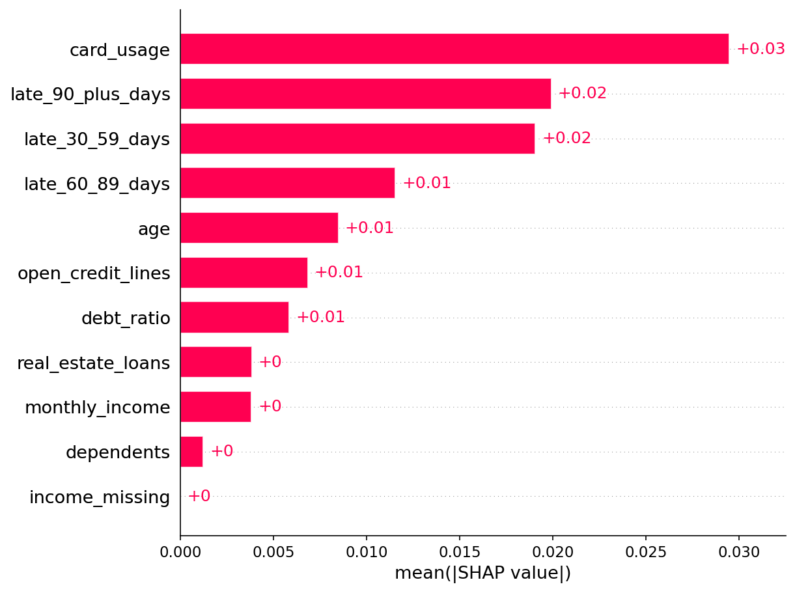
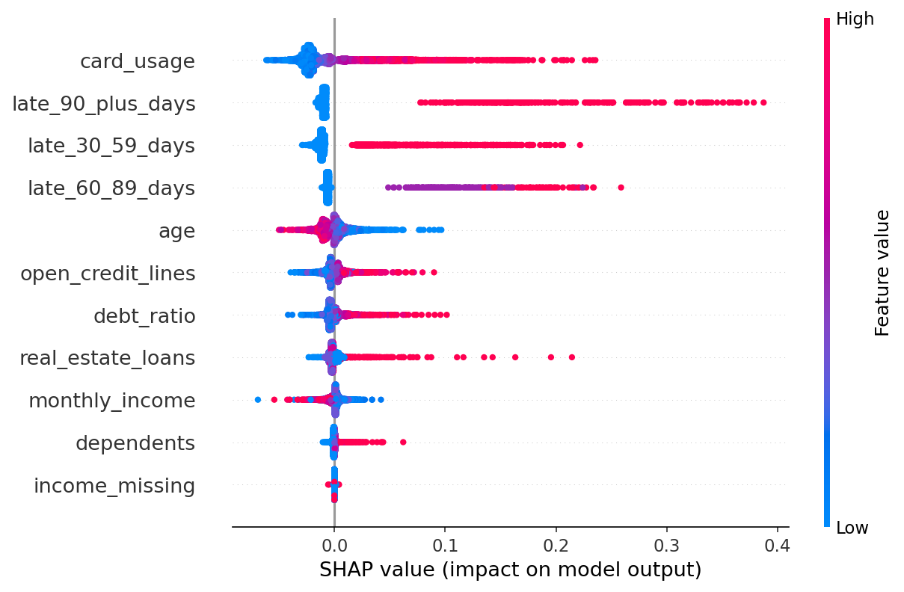
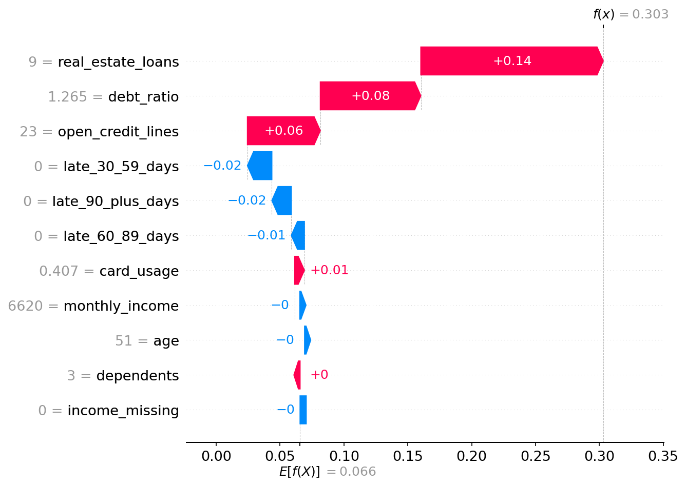
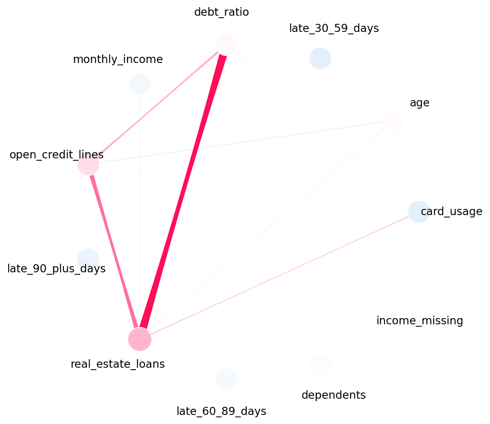

# Explaining a credit risk model with SHAP and LIME

A bank refuses a loan and the client asks why. This project builds a credit risk
model from the records of 150,000 borrowers and explains its answers with SHAP and LIME: what
each method does, step by step, and what each number means.

Everything is in one notebook:
[`notebooks/explaining_credit_risk.ipynb`](notebooks/explaining_credit_risk.ipynb).
It is committed with its outputs, so it can be read on GitHub without running it.

## The data

Kaggle, [Give Me Some Credit](https://www.kaggle.com/c/GiveMeSomeCredit): 150,000
borrowers and 10 features (card usage, age, three late-payment counts, debt ratio,
monthly income, open credit lines, real-estate loans, dependents). The target is 1
when the borrower went 90 or more days past due within two years. After cleaning
there are 149,730 borrowers and 6.6% of them defaulted.

The CSV is not in this repository because it is competition data.
[`data/README.md`](data/README.md) says how to get it.

## The model

Gradient boosting (`HistGradientBoostingClassifier` from scikit-learn, 86 trees).
AUC on the test set: **0.859**.

A model that says "nobody defaults" is 93.4% accurate here, so accuracy says little.
At a cut-off of 0.5 the model catches 17% of the defaulters; at 0.2 it catches 47%
and wrongly flags 1,457 good clients out of 27,970. The cut-off is a business choice.

## The method

1. Clean the data and train the model on 80% of the borrowers.
2. SHAP: split each prediction into one contribution per feature. First by hand on a
   toy example, then on the model, for 5,000 test clients.
3. SHAP-IQ: split two predictions further, into features and pairs of features.
4. LIME: fit a straight line around one client. First by hand in four steps, then
   with the `lime` library.
5. Compare SHAP and LIME on three clients, check the model for fairness on age,
   and list what the explanations cannot say.

## What the explanations show

All contributions are in percentage points of risk. The charts come straight from
the libraries and use probabilities, so +0.14 on a chart is +14 points.

### All clients



Card usage moves a client's risk by 2.95 points on average, more than any other
feature. The three late-payment counts follow. One delay of 90 days or more adds
14.6 points on average; one delay of 30–59 days adds 3.6.



One dot per client. Red is a high value of the feature, and a dot on the right
pushes the risk up. For age the colours are reversed: the model pushes young
clients up and older clients down.

### One client



This client has a risk of 30.3% and was never late. The risk comes from debt:
9 real-estate loans (+14.3), a debt ratio of 1.26 (+7.9) and 23 open credit lines
(+5.7). The bars add up exactly to the distance between the average risk (6.57%)
and 30.3%. The notebook checks this for 5,000 clients.

Two other clients are explained the same way: a late payer at 92.7% and a safe
client at 0.3%. The same model has a different reason for each of them.

### Interactions



A circle is a feature and a line is a pair of features; red pushes the risk up.
SHAP-IQ separates what a feature does on its own from what it does in a pair. On
their own, the 9 real-estate loans are worth +3.4 points. Their pair with the high
debt ratio is worth another +11.1. For this model, many real-estate loans
are dangerous when they come with high debt.

### SHAP against LIME

LIME is built twice: by hand, in four steps, and with the `lime` library. The
table compares what each explanation adds up to with the model's real answer.

| client | model | SHAP | LIME by hand | LIME library |
|---|---|---|---|---|
| debt | 30.3 | 30.3 | 25.3 | 10.2 |
| late payer | 92.7 | 92.7 | 103.0 | 61.8 |
| safe | 0.3 | 0.3 | −0.3 | −2.2 |

SHAP matches the model every time and gives the same numbers on every run. LIME
fits a straight line near the client, so it only approximates: the line can give
103% or a negative risk, and its numbers change with the random seed. Built by
hand, LIME ranks the features almost exactly as SHAP does (rank correlation
0.98–0.99). That is expected: the by-hand version uses the same keep-or-swap idea
as SHAP. The library is the independent method, and with its default bins it fits
these three clients poorly.

### Fairness: age

In every age group the model's average risk matches the real default rate, within
about half a point. With
one cut-off for everyone (0.2), 10.9% of the good clients up to 30 are refused
against 1.1% of the good clients over 70: ten times more. Training the model
without age lowers the AUC from 0.859 to 0.854, and good young clients are still
refused six times more often (9.2% against 1.5%).

The two results do not contradict each other. When two groups default at different
rates, a model cannot be calibrated in both and also have the same error rates in
both, unless it predicts perfectly (Kleinberg et al., 2017; Chouldechova, 2017).

### Four limits

1. **Unseen clients.** 269 rows with invalid codes were removed. Their default
   rate was 54.6%. The explanations say nothing about clients like them.
2. **Wrong inputs.** Some clients have an income of 0. SHAP explains that value as
   if it were correct.
3. **Importance 0 describes a column, not a group.** The "income missing" flag has
   an importance of 0.002 points: the model does not need it. The clients it marks
   still get a lower risk (5.2% against 6.8%), because they differ on other
   features. They use less of their cards, are older and are late less often.
4. **An explanation is not advice.** With 1 real-estate loan in place of 9, the
   model's risk for the debt client falls from 30.3% to 5.6%. That is the model's
   answer, not proof that the person would be a safer borrower.

## Run it

Tested with Python 3.11.

```bash
git clone https://github.com/simonefeli/explainable-credit-risk.git
cd explainable-credit-risk
python -m venv .venv
source .venv/bin/activate        # Windows: .venv\Scripts\activate
pip install -r requirements.txt
```

Download `cs-training.csv` into `data/` (see [`data/README.md`](data/README.md)).
Then open the notebook in VS Code and run all cells, or run it from the repository
root:

```bash
jupyter nbconvert --to notebook --execute --inplace notebooks/explaining_credit_risk.ipynb
```

The command rewrites the notebook with fresh outputs. The numbers are the same as in
the committed copy; a progress bar and an import warning are added. The run takes
about two minutes, most of it for SHAP on 5,000 clients.

## Files

```
notebooks/explaining_credit_risk.ipynb   the analysis, with outputs
figures/                                 the four charts above, written by the notebook
data/README.md                           how to download the data
requirements.txt                         package versions used for the committed run
```

## References

- Lundberg and Lee (2017). *A Unified Approach to Interpreting Model Predictions.* NeurIPS.
- Lundberg et al. (2020). *From local explanations to global understanding with explainable AI for trees.* Nature Machine Intelligence.
- Ribeiro, Singh and Guestrin (2016). *"Why Should I Trust You?": Explaining the Predictions of Any Classifier.* KDD.
- Muschalik et al. (2024). *shapiq: Shapley Interactions for Machine Learning.* NeurIPS.
- Fumagalli et al. (2023). *SHAP-IQ: Unified Approximation of any-order Shapley Interactions.* NeurIPS.
- Bordt and von Luxburg (2023). *From Shapley Values to Generalized Additive Models and back.* AISTATS.
- Kleinberg, Mullainathan and Raghavan (2017). *Inherent Trade-Offs in the Fair Determination of Risk Scores.* ITCS.
- Chouldechova (2017). *Fair prediction with disparate impact: A study of bias in recidivism prediction instruments.* Big Data.
- Kaggle (2011). *Give Me Some Credit.*

## License

The code is under the MIT license. The data is not included and stays under the
terms of the Kaggle competition.
